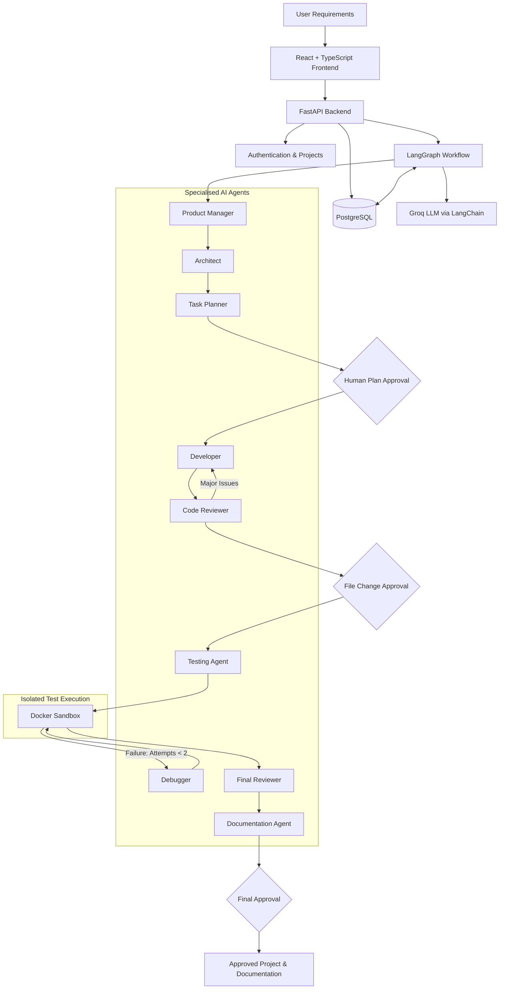

# DevTeam AI — Agentic Software Engineering Platform

**From natural language requirements to tested, documented software through a collaborative team of AI agents.**

DevTeam AI is an agentic software engineering platform that simulates a structured development team. Instead of relying on a single LLM to generate an entire application, it orchestrates specialised AI agents to analyse requirements, design architecture, break down tasks, generate code, review changes, execute tests, repair failures, and produce documentation.

Built with **LangGraph, LangChain, FastAPI, React, PostgreSQL, Groq, and Docker**, the platform combines multi-agent orchestration with deterministic workflow control and human-in-the-loop approvals.

**The core principle:** AI proposes and executes bounded development tasks, while humans retain control over the plan, individual file changes, and final delivery.

---

## Project Overview

| Attribute | Details |
|---|---|
| Project | DevTeam AI |
| Category | Agentic AI · Generative AI · AI Engineering |
| Architecture | Multi-Agent Workflow |
| Orchestration | LangGraph |
| LLM Integration | Groq API + LangChain |
| Backend | Python · FastAPI |
| Frontend | React · TypeScript · Tailwind CSS |
| Database | PostgreSQL · SQLAlchemy · Alembic |
| Execution Isolation | Docker Sandbox |
| Validation | Pydantic v2 |
| Workflow Control | Human-in-the-Loop |

## Key Capabilities

### 1. Multi-Agent Software Engineering

A specialised team of AI agents collaborates to transform requirements into working project files.

- **Product Manager:** Converts natural-language requirements into a structured product specification.
- **Architect:** Designs the application architecture and technical approach.
- **Task Planner:** Breaks the architecture into actionable development tasks.
- **Developer:** Generates implementation files.
- **Code Reviewer:** Analyses generated code and identifies major issues.
- **Testing Agent:** Prepares and initiates test execution.
- **Debugger:** Analyses failures and generates bounded fixes.
- **Final Reviewer:** Evaluates the resulting implementation.
- **Documentation Agent:** Generates project README and API documentation.

### 2. Stateful Agent Orchestration with LangGraph

The complete development lifecycle is modelled as a LangGraph state machine.

- Explicit graph nodes and conditional transitions.
- Rule-based supervisor for deterministic routing.
- Persistent workflow state across execution phases.
- Conditional retries based on review and testing outcomes.
- Execution monitoring with individual agent outputs.
- Maximum two automated repair attempts.

The supervisor uses deterministic routing rather than another LLM call, making workflow transitions predictable and traceable.

### 3. Human-in-the-Loop Approval System

Human approval is integrated directly into the development lifecycle.

- Review and approve the proposed development plan.
- Inspect individual file changes through a Git-style diff viewer.
- Approve or reject each generated change.
- Explicitly confirm dependencies not available in the sandbox.
- Review test results and the final implementation.
- Approve final documentation generation.

Approval decisions are persisted, allowing the workflow to continue across phases.

### 4. Structured LLM Outputs

Every agent produces structured JSON rather than relying entirely on free-form text.

- Pydantic v2 schema validation.
- Structured agent-specific outputs.
- Automatic retry for invalid JSON responses.
- Consistent data contracts between workflow stages.
- Traceable agent execution results.

### 5. Automated Testing and Self-Repair

Generated code is tested in an isolated Docker environment.

1. Testing Agent prepares the test execution.
2. Sandbox runs the configured pytest command.
3. Execution output and exit codes determine test status.
4. Debugger analyses failed tests and generates fixes.
5. The workflow retries testing, with a maximum of two repair attempts.
6. Final Reviewer evaluates the resulting implementation.

A test run with zero tests collected is not treated as a successful test run.

### 6. Development Workspace

Each project receives an isolated workspace containing generated application files.

- File explorer with source preview.
- Git-style diff inspection.
- Individual file approval and rejection.
- Project ZIP export.
- Repository search.
- Code outline using Python AST and regular expressions.
- Generated README and API documentation.

---

## System Architecture



## Agent Workflow

The workflow follows three logical development phases:

**Phase 1 — Planning**

```text
Requirements
    ↓
Product Manager
    ↓
Architect
    ↓
Task Planner
    ↓
Human Approval
```

**Phase 2 — Implementation**

```text
Developer
    ↓
Code Reviewer
    ↓
Conditional Developer Revisions
    ↓
Human File-by-File Approval
    ↓
Apply Approved Changes
```

**Phase 3 — Testing and Delivery**

```text
Testing Agent
    ↓
Docker Sandbox
    ↓
Debugger (Maximum 2 Attempts)
    ↓
Final Review
    ↓
Documentation
    ↓
Human Final Approval
```

Workflow state, agent execution steps, proposed changes, and test runs are persisted in PostgreSQL.

---

## Technology Stack

| Layer | Technologies |
|---|---|
| Frontend | React, TypeScript, Vite, Tailwind CSS |
| Backend | Python, FastAPI |
| Agent Orchestration | LangGraph |
| LLM Integration | LangChain, Groq |
| Output Validation | Pydantic v2 |
| Database | PostgreSQL |
| ORM & Migrations | SQLAlchemy, Alembic |
| Authentication | JWT |
| Execution Environment | Docker |
| Testing | Pytest, Vitest |
| Code Quality | Ruff |
| Development | Git, Docker Compose |

---

## Security and Reliability

Security is a core architectural consideration because the platform generates executable code.

**Isolated execution**

- Generated code is never executed directly on the backend host.
- Tests execute inside Docker containers with networking disabled.
- Non-root execution using UID 65534.
- Linux capabilities dropped.
- Read-only container filesystem.
- CPU, memory, process-count, and execution-time limits.
- Workspace snapshots mounted read-only.
- Fixed test command and controlled environment variables.

**Workspace protection**

- Relative path validation.
- Prevention of directory traversal and absolute paths.
- Rejection of symlinks and restricted paths.
- Write-time path containment verification.
- Protection of environment files and Git metadata.

**LLM input handling**

- Repository and test content are explicitly marked as untrusted prompt data.
- Agent outputs are validated against Pydantic schemas.
- File modifications pass through approval controls.
- Debugger writes are bounded, recorded, and visible to the final reviewer.

**Important deployment consideration:** The Docker Compose backend uses the Docker socket to launch sandbox containers. Access to this socket is effectively root-equivalent on the host. For safer development, run the backend on the host and use Docker only for isolated test execution.

---

## Project Structure

```text
dev-team-ai/
│
├── backend/
│   ├── app/
│   │   ├── routers/
│   │   ├── services/
│   │   ├── agents/
│   │   ├── workflow/
│   │   └── llm/
│   ├── workspaces/
│   ├── requirements-dev.txt
│   └── alembic/
│
├── frontend/
│   └── src/
│       ├── pages/
│       ├── components/
│       └── lib/
│
├── sandbox/
│   └── Dockerfile
│
├── docker-compose.yml
├── .env.example
└── README.md
```

---

## Getting Started

### Prerequisites

- Python 3.12
- Node.js 20+
- Docker Desktop
- PostgreSQL (provided through Docker Compose)
- Groq API key

### 1. Clone the Repository

```powershell
git clone https://github.com/shatakshi-1404/dev-team-ai.git
cd dev-team-ai
```

### 2. Start PostgreSQL

```powershell
docker compose up -d db
```

### 3. Build the Sandbox Image

```powershell
docker build -t devteam-sandbox:latest sandbox
```

### 4. Configure the Backend

```powershell
cd backend

python -m venv .venv
.\.venv\Scripts\Activate.ps1

pip install -r requirements-dev.txt

copy .env.example .env
```

Configure the required environment variables in `backend/.env`:

```env
DATABASE_URL=postgresql+psycopg://...
SECRET_KEY=your-secret-key
GROQ_API_KEY=your-groq-api-key
GROQ_MODEL=your-supported-groq-model
```

Run database migrations:

```powershell
alembic upgrade head
```

Start the backend:

```powershell
uvicorn app.main:app --reload --port 8000
```

### 5. Configure the Frontend

Open another terminal:

```powershell
cd frontend

npm install
copy .env.example .env

npm run dev
```

Open:

**http://localhost:5173**

The backend can start without a Groq API key, but agent workflow execution requires a configured key.

---

## Running Tests

### Backend

```powershell
cd backend

pytest -q
ruff check .
ruff format --check .
```

### Frontend

```powershell
cd frontend

npm test
npm run typecheck
npm run build
```

---

## Demo: Build a URL Shortener

The repository includes a URL shortener example to demonstrate the complete workflow.

1. Register and create a new project.
2. Select **Use the URL shortener example**.
3. Start the agent workflow.
4. Review the generated specification, architecture, and tasks.
5. Approve the development plan.
6. Inspect proposed changes in the Changes tab.
7. Approve or reject individual files.
8. Apply approved changes and initiate testing.
9. Monitor sandbox execution and any repair attempts.
10. Review the final output and approve documentation.
11. Download the generated project as a ZIP.

---

## Current Limitations

This is an actively evolving engineering project. Some capabilities are intentionally outside the current implementation.

- Only pytest executes inside the sandbox; generated frontend Vitest tests are not executed there.
- Network access is disabled in the sandbox, restricting dependencies to preinstalled packages.
- Git commit and push integration is not implemented; projects can be exported as ZIP files.
- Docker Compose backend socket access carries host-level security implications.
- Rate limiting, email verification, and token revocation are not implemented.
- LLM output quality depends on the configured Groq model.

---

## Engineering Concepts Demonstrated

- Multi-agent systems and agent specialization.
- Stateful workflow orchestration using LangGraph.
- Conditional graph routing and bounded retries.
- Human-in-the-loop AI systems.
- Structured generation and schema validation.
- LLM integration through LangChain.
- Backend architecture and persistent workflow state.
- Secure execution of AI-generated code.
- Docker isolation and resource constraints.
- Failure analysis and automated repair loops.
- Full-stack application development.

---

## Author

**Shatakshi Prasad**

B.Tech Computer Science & Engineering | AI/ML Specialization

- GitHub: [shatakshi-1404](https://github.com/shatakshi-1404)
- LinkedIn: [Shatakshi Prasad](https://linkedin.com/in/shatakshi-prasad)

---

**DevTeam AI — Building software with AI agents, structured workflows, and human oversight.**
